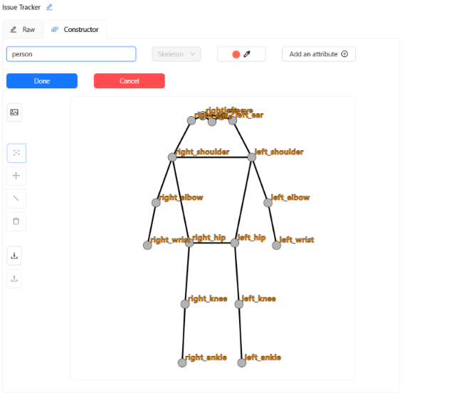
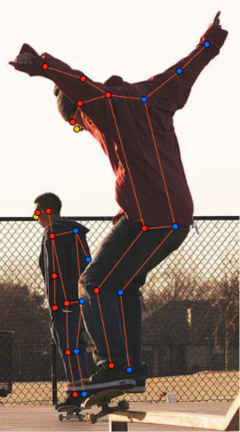
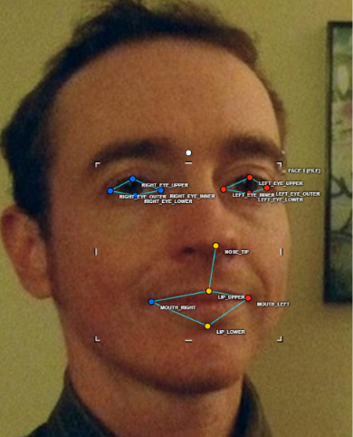
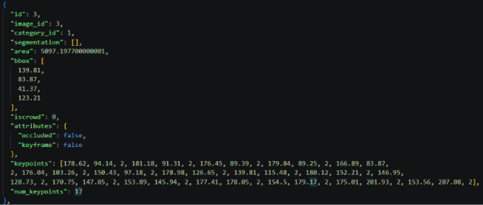

# Báo cáo cá nhân — HoVaTen-MSSV

Đổi tên file theo quy tắc `MSSV_HoTen.md`. Ví dụ: `20241234_NguyenVanAn.md`.

Dữ liệu: 12 ảnh người COCO val2017 (Lin et al., 2014) và 8 ảnh chân dung Wikimedia Commons, chỉ dùng trong lớp.

## 0. Thông tin học viên

- Họ tên: Đỗ Thị Kim Oanh
- MSSV: 2A202604034
- Email: 26ai.oanhdtk@vinuni.edu.vn 
- Link repository: [repo](https://github.com/DoThiKimOanhB22DCCN606/K5-L2B-DAY04-DoThiKimOanh-202604034-KeypointPose/tree/main)
- Phiên bản CVAT (Help → About):
- Máy: hệ điều hành Windows · RAM 32 GB · chạy CVAT chế độ đầy đủ / lite
- Bộ ảnh (`src/exports/assignment.json` do `lab.py setup` tạo): có / không
- Giờ bắt đầu:
- Giờ kết thúc:

## 1. Kiểm tra label (CP0)

| Label | Kiểu | Số điểm | Tên điểm đúng bảng của lab? | Đúng thứ tự? | Số cạnh |
|---|---|---:|---|---|---:|
| `person` | Skeleton | 17 | Có, khớp schema và file xuất | Có, khớp schema và file xuất | 19 |
| `face` | Skeleton | 13 | Có, khớp schema và file xuất | Có, khớp schema và file xuất | 13 |

Mẫu `person` dựng theo người quay mặt về camera (các điểm `left_*` nằm bên phải khung mẫu)? Có 
Cách đổi cờ `occluded` / `outside` cho **một điểm** trên phiên bản CVAT này (một câu): di chuột trực tiếp lên điểm đó và nhấn phím tắt (Q cho occluded, O cho outside)

...

## 2. Số lượng đã gán và thời gian (CP1, CP2)

| Nhóm ảnh | Số ảnh | Số skeleton đã gán | Số người dưới 60 px (không gán) | Số poster / gương / màn hình bỏ qua | Thời gian (phút) |
|---|---:|---:|---:|---:|---:|
| `easy` | 5 | 5 | | | |
| `occluded` | 3 | 6 | | | |
| `back` | 2 | 4 | | | |
| `small` | 1 | 5 | | | |
| `crowd` | 1 | 3 | | | |
| `faces` | 8 | 8 | | | |

- Số ảnh người đã xong ở mốc phút 105: 10 / 10
- Thời gian thực tế (phút): CP1 30 · CP2 30 · CP3 20
- Ảnh tốn thời gian nhất là ảnh nào, vì sao? Ảnh 000000043500.jpg tốn thời gian nhất, vì người quá nhỏ, đứng xa nên khó xác định các khớp xương.

...

## 3. Bảng ca khó (CP1, CP2)

Mỗi điểm bạn phân vân một dòng, nhất là phân vân giữa `v = 1` và `v = 0`, hoặc không chắc hướng người.

| Ảnh | Người / mặt | Điểm | Cờ đã chọn | Phân vân giữa | Lý do chọn |
|---|---|---|---:|---|---|
| `000000122199.jpg` | Người #5 | `left_shoulder` | `v=2` | `v=2` / `v=0` | Tọa độ xuất là x=480, đúng mép phải ảnh; guideline yêu cầu `outside` nếu khớp nằm ngoài khung. Review đề xuất kiểm lại ảnh gốc và đổi `v=0` nếu vai thực sự ngoài khung. |
| `000000522889.jpg` | Người #21 | `left_ankle`, `right_ankle` | `v=2` | `lr_swap` / chân bắt chéo thật | Quan sát ảnh vận động viên đang nhảy cho thấy chân gập/bắt chéo; không nên đổi tên chỉ dựa vào thứ tự trái-phải trên ảnh. |
| `face_301643.jpg` | Mặt #3 | 4 điểm `*_eye_*` | `v=1` | `v=1` / `v=0` | Mắt bị kính râm tối che; guideline quy định `occluded` (`v=1`) nếu ước lượng vị trí chắc theo gọng kính, nếu không chắc thì `outside` (`v=0`).|

## 4. Bảng tự review (CP3)

Đi từ ảnh cuối về ảnh đầu. 5 ảnh người (ít nhất 2 ảnh `back` hoặc `crowd`) và 3 ảnh mặt. Ít nhất 8 dòng, kể cả dòng `ok`. Ghi lỗi trước, sửa sau.

Mã lỗi dùng đúng một trong: `lr_swap`, `vis_flag`, `position`, `missing`, `extra`, `ok`.

| Ảnh | Người / mặt | Điểm | Mã lỗi | Ghi chú | Đã sửa? |
|---|---|---|---|---|---|
| `000000522889.jpg` | Người #21 | Cổ chân | `ok` | Xem ảnh vận động viên đang bật nhảy, hai chân bắt chéo là tư thế thật nên không đổi tên trái/phải chỉ theo x-coordinate. | Giữ nguyên sau khi đối chiếu ảnh |
| `000000480582.jpg` | Người #18 | Skeleton | `ok` | Đối chiếu overlay ở ảnh người chăn cừu; các điểm nhìn thấy bám theo người, không thấy lỗi hiển nhiên ở mẫu review. | Không cần sửa trong mẫu review |
| `000000043500.jpg` | Người #4 | Các điểm `v=0` | `ok` | Người ở khu vực toa tàu bị che một phần; các điểm không có trong annotation đang được để `outside`, không kéo về mép. | Không cần sửa trong mẫu review |
| `000000122199.jpg` | Người #5 | `left_shoulder` | `vis_flag` | Vai có tọa độ x=480 ở biên phải ảnh nhưng xuất hiện `v=2`; cần xem ảnh gốc và đặt `outside` nếu khớp nằm ngoài khung. | Đã sửa trên CVAT |
| `000000438099.jpg` | Người #12, #14–#16 | Skeleton dưới 60 px | `extra` | Checker báo chiều cao keypoint 40, 34, 31, 58 px. Theo guideline, không gán người thật dưới 60 px; cần xác minh từng instance trong ảnh nhỏ và xóa instance không đạt ngưỡng/không phải người thật. | Đã sửa trên CVAT |
| `face_81239.jpg` | Mặt #8 | 13 điểm | `ok` | Mắt sau kính trong vẫn quan sát được trên ảnh; giữ các điểm nhìn thấy ở `v=2`. | Không cần sửa trong mẫu review |
| `face_490361.jpg` | Mặt #6 | 13 điểm | `ok` | Đối chiếu overlay: điểm mắt, mũi và miệng nằm trên mặt; không có cảnh báo cấu trúc từ checker. | Không cần sửa trong mẫu review |
| `face_301643.jpg` | Mặt #3 | 4 điểm mắt | `vis_flag` | Kính râm tối che mắt nhưng file hiện để cả 4 điểm mắt `v=2`; theo guideline nên dùng `v=1` nếu có thể ước lượng chắc theo gọng, nếu không thì `v=0`. | Đã sửa trên CVAT |

Tổng hợp số lỗi theo mã:

| `lr_swap` | `vis_flag` | `position` | `missing` | `extra` | `ok` |
|---:|---:|---:|---:|---:|---:|
| 0 | 2 | 0 | 0 | 1 | 5 |

Điểm còn phân vân giữa `v = 1` và `v = 0` (ghi cả hai lựa chọn và lý do chọn):
Hai điểm phân vân chính khi review: (1) vai trái của người #5 trong `000000122199.jpg` đang `v=2`; chọn `v=0` nếu vai ngoài khung, vì tọa độ x chạm đúng biên phải; (2) bốn điểm mắt trong `face_301643.jpg` đang `v=2`; chọn `v=1` nếu vị trí sau kính râm ước lượng chắc theo gọng, nếu không thì `v=0`. Cả hai cần sửa trong CVAT rồi export lại; không sửa trực tiếp JSON.
...

## 5. Kiểm file xuất và kết quả tự kiểm (CP4)

Tự kiểm tay trong file JSON:

| File | Người / mặt kiểm (ảnh, thứ tự) | Số phần tử `keypoints` | Điểm `outside` ra `v = 0`, `occluded` ra `v = 1`? | `num_keypoints` khớp? |
|---|---|---:|---|---|
| `DoThiKimOanh_persons.zip` | `000000043500.jpg`, skeleton #4 | 51 | `outside`: có (4 điểm `v=0`); không có `v=1` để kiểm `occluded` | Có (`13/13`) |
| `DoThiKimOanh_persons.zip` | `000000122199.jpg`, skeleton #5 | 51 | `outside`: có (2 điểm `v=0`); không có `v=1` để kiểm `occluded` | Có (`15/15`) |
| `DoThiKimOanh_faces.zip` | `face_125051.jpg`, skeleton #1 | 39 | Trong file không có `v=0` hoặc `v=1` để kiểm | Có (`13/13`) |

Sau khi xuất, CVAT ghi `occluded` thành `v = 1` và `outside` thành `v = 0`. Tọa độ của điểm `outside` trong file là `0, 0` hay tọa độ cũ? Tọa độ cũ.

Hai job đã chuyển sang completed trên CVAT? Có.

Dán phần **TÓM TẮT** in ra từ `src/check_submission.py`:

```text
  [CẢNH BÁO] 000000122199.jpg #1: `left_shoulder` v = 2 nằm sát mép ảnh (480, 215). Nếu khớp thật ở ngoài ảnh, bật outside thay vì kéo về mép.
  [CẢNH BÁO] 000000122199.jpg #2: cặp knee nằm ngược phía so với các cặp còn lại. Có thể đổi trái/phải một cặp (`lr_swap`), hoặc tay / chân bắt chéo thật: kiểm lại.
  [CẢNH BÁO] 000000360811.jpg #2: `right_wrist` v = 2 nằm sát mép ảnh (1, 319). Nếu khớp thật ở ngoài ảnh, bật outside thay vì kéo về mép.
  [CẢNH BÁO] 000000438099.jpg #1: các điểm chỉ trải cao 40 px (< 60 px). Người dưới 60 px không gán; nếu người cao hơn nhưng bị cắt khung thì bỏ qua cảnh báo này.
  [CẢNH BÁO] 000000438099.jpg #3: các điểm chỉ trải cao 34 px (< 60 px). Người dưới 60 px không gán; nếu người cao hơn nhưng bị cắt khung thì bỏ qua cảnh báo này.
  [CẢNH BÁO] 000000438099.jpg #4: các điểm chỉ trải cao 31 px (< 60 px). Người dưới 60 px không gán; nếu người cao hơn nhưng bị cắt khung thì bỏ qua cảnh báo này.
  [CẢNH BÁO] 000000438099.jpg #5: các điểm chỉ trải cao 58 px (< 60 px). Người dưới 60 px không gán; nếu người cao hơn nhưng bị cắt khung thì bỏ qua cảnh báo này.
  [CẢNH BÁO] 000000522889.jpg #1: cặp ankle nằm ngược phía so với các cặp còn lại. Có thể đổi trái/phải một cặp (`lr_swap`), hoặc tay / chân bắt chéo thật: kiểm lại.
  [CẢNH BÁO] 000000522889.jpg #2: `left_shoulder` v = 2 nằm sát mép ảnh (276, 0). Nếu khớp thật ở ngoài ảnh, bật outside thay vì kéo về mép.
  [CẢNH BÁO] 000000522889.jpg #2: `right_shoulder` v = 2 nằm sát mép ảnh (243, 0). Nếu khớp thật ở ngoài ảnh, bật outside thay vì kéo về mép.

=== src\exports\DoThiKimOanh_faces.zip (label `face`) ===

----- TÓM TẮT (dán vào báo cáo mục 5) -----
- File person: DoThiKimOanh_persons.zip
  Số ảnh: 12 · số skeleton `person`: 23 · mỗi annotation 51 số
  Skeleton theo ảnh: 000000021235=1, 000000027565=1, 000000043500=2, 000000122199=2, 000000156986=2, 000000294329=1, 000000360811=2, 000000438099=5, 000000463932=1, 000000480582=2, 000000493741=1, 000000522889=3
  Cờ v: v=2 297 (76%) · v=1 0 (0%) · v=0 94 (24%)
  num_keypoints trung bình: 12.9
- File face: DoThiKimOanh_faces.zip
  Số ảnh: 8 · số skeleton `face`: 8 · mỗi annotation 39 số
  Skeleton theo ảnh: face_125051=1, face_300399=1, face_301643=1, face_421231=1, face_449454=1, face_490361=1, face_79591=1, face_81239=1
  Cờ v: v=2 104 (100%) · v=1 0 (0%) · v=0 0 (0%)
  num_keypoints trung bình: 13.0
- Ghi chú: 94 điểm v = 0 vẫn mang tọa độ cũ (CVAT 2.x xuất như vậy; chuẩn COCO ghi 0, 0). Không phải lỗi: điểm v = 0 bị bỏ qua khi huấn luyện và khi chấm.
- Số [LỖI]: 0 · số [CẢNH BÁO]: 10
Kết quả: ĐẠT (đọc lại từng cảnh báo ở trên)
```

Các `[CẢNH BÁO]` còn giữ nguyên và lý do:
| Ảnh | Cảnh báo | Trạng thái / lý do |
|---|---|---|
| `000000522889.jpg` #1 | Cặp ankle nằm ngược phía so với các cặp còn lại. | Đã đối chiếu ảnh: vận động viên đang nhảy, hai chân bắt chéo; giữ nguyên, không đổi trái/phải chỉ theo x-coordinate. |

Tổng cộng 10 cảnh báo: 1 cảnh báo ankle được giữ vì phù hợp tư thế chân bắt chéo.
...

## 6. Ảnh chụp màn hình

1. Label `person` trong label constructor (đủ 17 điểm có tên):

   

2. Một người quay lưng đã gán, cờ đã đặt:

   

3. Một khuôn mặt đã gán 13 điểm, phóng to vùng mắt:

   

4. Một đoạn JSON xuất của một người:

   

Nguồn ảnh: COCO val2017 / Wikimedia Commons.

## 7. Tự đánh giá

1. Lỗi bạn mắc nhiều nhất hôm nay, và cách bạn sẽ tránh ở dự án thật:
Trong bản nháp được rà soát, vấn đề nổi bật là cờ visibility và detection nhỏ chưa được lọc đủ: có điểm vai/cổ tay sát biên vẫn để `v=2`, bốn skeleton trong ảnh `000000438099.jpg` thấp hơn ngưỡng 60 px, và các điểm mắt sau kính râm vẫn để `v=2`. Ở dự án thật, tôi sẽ kiểm tra ảnh gốc ở độ phóng đại cao, rà từng điểm sát biên và lọc detection theo quy tắc.
   ...

2. Một quy tắc bạn đề xuất thêm vào guideline (kèm ảnh ví dụ nếu có):
Thêm bước bắt buộc “review điểm biên và detection nhỏ”: mọi keypoint nằm sát biên ảnh phải được xác nhận là khớp nhìn thấy (`v=2`) hay nằm ngoài ảnh (`v=0`); mọi skeleton có chiều cao keypoint dưới 60 px phải được kiểm riêng để tránh giữ người quá nhỏ hoặc detection giả.
   ...

3. Nhãn của bạn đi vào model ở đâu? Chọn một lỗi bạn đã sửa và nói nó sẽ làm model học sai thế nào (heatmap, trọng số trong loss, hay bước lật ảnh):
Trong export hiện tại, bốn điểm mắt của `face_301643.jpg` đang là `v=2` dù bị kính râm tối che; lỗi này đã được phát hiện nhưng chưa được xác nhận là đã sửa trên CVAT. Nếu giữ nguyên, huấn luyện sẽ tạo target heatmap tại các tọa độ mắt bị che và tính loss như điểm nhìn thấy, khiến model bị phạt khi dự đoán vị trí mắt thật thay vì được đánh dấu occluded (`v=1`) hoặc bỏ khỏi loss (`v=0`) khi không thể ước lượng chắc. Cần sửa trên CVAT và export lại.
   ...

## 8. Khó khăn và lỗi kỹ thuật
Không có.

...

## Bonus (nếu làm)

### B1 — 3 ảnh người khó thêm

| Ảnh | Số skeleton | Số người dưới 60 px | Ca khó nhất |
|---|---:|---:|---|
| `000000005294.jpg` | 3 | 0 | Người #1: tư thế ngồi với hai chân chồng/bắt chéo; checker báo cặp ankle lệch bên. Cần xác nhận trái/phải theo cơ thể, không đổi chỉ dựa vào thứ tự tọa độ ngang. |
| `000000073537.jpg` | 3 | 0 | Người #2: bị che/cắt mạnh ở phía trái; chỉ có 5 keypoint đang hiển thị và `left_shoulder` nằm sát mép trái (0, 369). Cần rà từng điểm xem là nhìn thấy hay ngoài khung. |
| `000000465765.jpg` | 3 | 0 | Người #3: tư thế trượt tuyết nghiêng; checker báo cặp mắt/tai lệch bên. Cần kiểm tra hướng cơ thể và tên trái/phải theo người. |

Kết quả `src/check_submission.py` cho `HoVaTen_bonus_persons.zip`:

```text
[CẢNH BÁO] 000000005294.jpg #1: cặp ankle nằm ngược phía so với các cặp còn lại.
[CẢNH BÁO] 000000073537.jpg #2: `left_shoulder` v=2 nằm sát mép ảnh (0, 369).
[CẢNH BÁO] 000000465765.jpg #3: cặp eye, ear nằm ngược phía so với các cặp còn lại.
Số ảnh: 3 · số skeleton person: 9 · mỗi annotation 51 số
Skeleton theo ảnh: 000000005294=3, 000000073537=3, 000000465765=3
Cờ v: v=2 115 (75%) · v=1 0 (0%) · v=0 38 (25%)
num_keypoints trung bình: 12.8
Số [LỖI]: 0 · số [CẢNH BÁO]: 3
Kết quả: ĐẠT (đọc lại từng cảnh báo ở trên)
```

### B2 — 5 ảnh khuôn mặt đen trắng / hồng ngoại

Ảnh không màu khó hơn ở điểm nào? Kính râm trên ảnh hồng ngoại có còn là `v = 1` không?
Ảnh không màu làm giảm tín hiệu màu giúp phân biệt mắt, môi, kính và vùng bị che; cần dựa nhiều hơn vào biên dạng và tương quan hình học. Kính chỉ là `v=1` nếu mắt bị che nhưng có thể ước lượng chắc; không tự động gán `v=1` chỉ vì ảnh là hồng ngoại/đen trắng. Trong file bonus hiện tại có 5 mặt và toàn bộ 65 điểm là `v=2`; cần đối chiếu lại với ảnh để xác nhận cờ visibility.

...

### B3 — Model so với nhãn của tôi (không tính điểm)

- Demo đã dùng:
- Ảnh đã thử:

1. Model có trả điểm cho khớp bị che, hay khớp ngoài ảnh không? Confidence ở các điểm đó thế nào?

   ...

2. Với người quay lưng, model có đổi trái/phải không?

   ...

3. Bộ điểm của model có giống 17 điểm COCO không?

   ...

## 9. Tài liệu tham khảo và công cụ AI đã dùng
Tài liệu: `README.md`, `RULES.md`, `docs/GUIDELINE.md`, `docs/COCO_KEYPOINTS.md`, `src/keypoint_schema.json`, `src/lab/NGUON_ANH.md`. Công cụ: CVAT.

...
